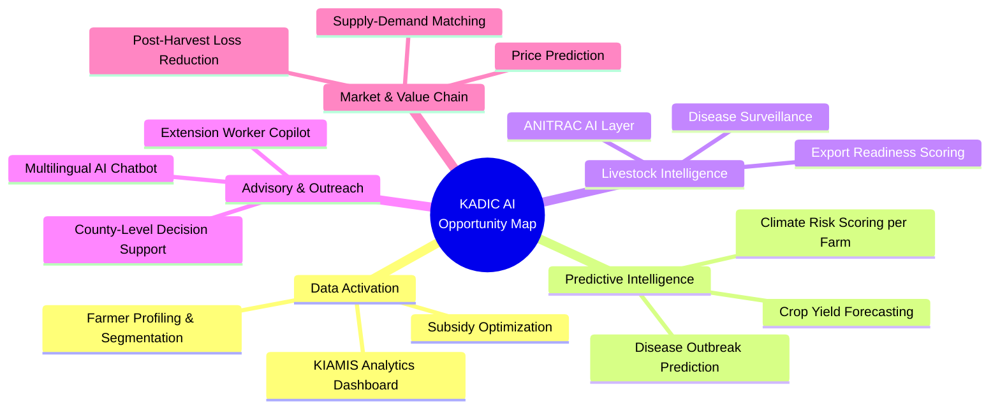

# 🌾 Leveraging AI in Kenya's Ministry of Agriculture — KADIC/AIRC

## Deep Research Report | May 2026

---

# PART 1: Current Ministry Projects (Funded & Running)

## 1.1 KADIC / AIRC — Your Home Base

KADIC (Kenya Agriculture Data and Information Centre), formerly AIRC, has been restructured as the **central command hub for agricultural data and intelligence** in Kenya. This is extremely strategic — you are sitting at the nerve center.

### Systems KADIC Manages:
| System | What It Does | Status |
|--------|-------------|--------|
| **KIAMIS** (Kenya Integrated Agriculture Management Information System) | National farmer registry — **7.2M+ registered farmers** with geo-referenced farm data, crop data, soil info | ✅ Operational, data growing |
| **ANITRAC** (Animal Identification & Traceability System) | RFID-based livestock tracking — birth to slaughter, vaccination, movement, health | 🟡 Pilot launched May 2025, expanding 2026. ANITRAC Bill 2026 in public participation |
| **e-Voucher Platform** | Digital subsidized input distribution to farmers | ✅ Operational |
| **Soil Health Information System** | Soil testing data and agronomic advisories | ✅ Operational |

> [!IMPORTANT]
> **Your strategic advantage**: KADIC sits on arguably the richest agricultural dataset in East Africa (7.2M farmers, livestock RFID data, soil health, weather). The AI opportunity is in **activating** this data — turning it from a static registry into a predictive, prescriptive intelligence engine.

---

## 1.2 Major Funded Projects in the Agriculture Ministry (FY 2025/26)

| Project | Budget (KShs) | Funder | Digital/AI Component | Status |
|---------|---------------|--------|---------------------|--------|
| **NAVCDP** (National Agricultural Value Chain Development Project) | 10.2B | World Bank / AfDB | 6.4M farmers registered digitally; 3,000+ agripreneurs deployed with digital tools; SACCO & FPO digitization | 🟢 Active — MTR completed late 2025, moving from data collection to operational phase |
| **Food Systems Resilience Project (FSRP)** | 5.8B | World Bank | Climate risk data analytics, big data advisory platform, geospatial food security mapping | 🟢 Active |
| **Kenya Financing Locally Led Climate Action** | 11.5B | World Bank / GCF | Climate resilience for agriculture, data-driven vulnerability mapping | 🟢 Active |
| **Fertilizer Subsidy Programme** | 8.0B | GoK | e-Voucher digital distribution via KIAMIS | 🟢 Active |
| **KeLCoP** (Kenya Livestock Commercialization Programme) | 1.6B | World Bank | Matching grants, value chain digitization | 🟢 Active |
| **KCSAP** (Kenya Climate Smart Agriculture Project) | Completed 2022 | World Bank | Big Data platform (KALRO), DigiCow, One Million Farmer Platform foundation | ✅ Completed — successor programs building on it |
| **Blue Economy & Fisheries** | 8.2B | World Bank / AfDB | Aquaculture Business Development, marine monitoring | 🟢 Active |

---

## 1.3 KALRO AI Initiatives (Key Partner)

KALRO (Kenya Agricultural and Livestock Research Organization) is a critical ally for your work:

| Initiative | Partner | What It Does |
|-----------|---------|--------------|
| **KALRO × SatSure** | SatSure Analytics India | Earth Observation + AI: crop health monitoring, yield forecasting, soil health assessment via satellite imagery & ML |
| **AgriAdvisor** (AI Copilot) | TomorrowNow.org / Tomorrow.io | GenAI-powered real-time agronomy + weather advice in English/Swahili for smallholder farmers |
| **Big Data Platform** | World Bank / KCSAP legacy | Mobile apps, web portals, SMS for agro-weather, market info, and climate-smart advisories |

---

# PART 2: What International Financiers Are Funding

## 2.1 The Big Money — Where It's Going

### African Development Bank (AfDB)

| Initiative | Amount | Focus | AI/Data Relevance |
|-----------|--------|-------|-------------------|
| **AI 10 Billion Initiative** (with UNDP) | Up to **$10B by 2035** | Five pillars: Data, Compute, Skills, Trust, Capital | Agriculture projected to capture **20% of AI productivity gains**. This is THE big play. |
| **TAAT-III** (Technologies for African Agricultural Transformation) | $16.61M grant | Digital tools, e-catalogues, real-time monitoring, climate-resilient tech, improved seed systems | Digital tools & real-time monitoring = AI opportunity |
| **MADE Alliance** (Modernizing Agriculture & Digital Ecosystems) | $300M (first 5 years) | High-speed internet for agri, digital skills, cooperative digitization, farmer bankability | Infrastructure layer that AI projects can build on |

### World Bank

| Initiative | Amount | Focus | AI/Data Relevance |
|-----------|--------|-------|-------------------|
| **AgriConnect** | $9B/year target (global) | Infrastructure, policy reform, digital transformation for surplus production | Major push for digital agriculture |
| **Data for Soil Health & Innovation Challenge** | Challenge-based | AI/ML/Big Data for soil health, precision fertilizer use | Direct AI funding opportunity |
| **Kenya Portfolio** | $5.96B (31 active projects) | Agriculture value chains, economic transformation | Multiple entry points for data/AI |

### CGIAR System

| Initiative | Focus | AI/Data Relevance |
|-----------|-------|-------------------|
| **CGIAR AI Hub** (with UAE, Gates Foundation) | AgriLLM (agriculture-specific LLM), Genebank AI | Build agricultural AI models |
| **GAIA** (Generative AI for Agriculture — IFPRI) | AI chatbots using RAG for localized farming advice | Phase II (2025-2027) expanding to multimodal |
| **AICCRA** (Accelerating Impacts of CGIAR Climate Research for Africa) | AI + Earth Observation for climate resilience, precision farming | Directly relevant to Kenya |
| **Digital Transformation Accelerator** | "Digital brains" in crop breeding (with Google) | Genomics + AI |

### USAID / Feed the Future

| Focus | AI/Data Relevance |
|-------|-------------------|
| Crop yield improvement, pest management, resource efficiency | AI for prediction and optimization |
| FASA Fund — agricultural SME financing | AI/deep learning for risk assessment |

### FAO

| Initiative | AI/Data Relevance |
|-----------|-------------------|
| **Digital Villages Initiative** | AI-driven chatbots and advisory in rural communities |
| **Hand-in-Hand Initiative** | Geospatial Platform with ML for remote sensing, soil/water/climate/crop health data |

### Bill & Melinda Gates Foundation

| Focus | AI/Data Relevance |
|-------|-------------------|
| CGIAR AI Hub co-funder | AgriLLM, Genebank AI |
| Smallholder farmer digital tools | Voice-enabled AI, multilingual support |

> [!TIP]
> **Funding pattern**: Financiers are converging on five themes:
> 1. **Climate resilience** (prediction + adaptation)
> 2. **Farmer advisory services** (AI chatbots, GenAI)
> 3. **Data infrastructure** (standardization, interoperability)
> 4. **Market access & value chain** (supply chain optimization)
> 5. **Precision agriculture** (satellite + IoT + AI)

---

# PART 3: What's Already Being Done (Existing AI Solutions in Kenya)

Understanding the landscape helps you **avoid duplication** and find **white spaces**:

| Solution | Developer | What It Does | Limitation / Gap |
|----------|-----------|-------------|-----------------|
| **PlantVillage Nuru** | Penn State / IITA | CV-based crop disease detection (offline, Swahili) | Limited to a few crops (maize, cassava). Not integrated with KIAMIS |
| **Plantix** | PEAT GmbH | Disease diagnosis + outbreak mapping via GPS data | Foreign-developed, no govt data integration |
| **Farmer Lifeline** | Kenyan startup | Solar-powered AI robot for field monitoring | Hardware-dependent, expensive to scale |
| **Kuzi** | Kenyan startup | Locust prediction via satellite + soil + weather ML | Narrow focus (locusts only) |
| **DigiCow** | KCSAP partner | Dairy record-keeping mobile app | Limited analytics, not AI-powered |
| **AgriAdvisor** | KALRO + TomorrowNow | GenAI weather + agronomy advice | Early pilot, limited crop coverage |
| **Virtual Agronomist** | iSDA | ML-based fertilizer recommendations from satellite/soil data | External to ministry |
| **Farmer.Chat** | Digital Green | AI chatbot for localized farming advice | Limited Kenya deployment |
| **Farmonaut** | Commercial | Satellite farm monitoring + AI advisory | Commercial SaaS, not ministry-integrated |

> [!WARNING]
> **Key Gap**: Almost NONE of these solutions are integrated with KADIC's existing data (KIAMIS, ANITRAC, soil health). The ministry has the data but lacks the AI layer. External solutions exist but don't connect to government systems. **This is your biggest opportunity.**

---

# PART 4: Gap Analysis — Where AI Can Add Value at KADIC

Based on the research, here are the **underserved areas** where KADIC can lead:

---

# PART 5: 🚀 Recommended AI Projects (Demo-Ready Ideas)

## Evaluation Criteria Used:
- ✅ Uses existing KADIC data (KIAMIS, ANITRAC, soil health)
- ✅ Aligned with funder priorities
- ✅ Demoable in 2-4 weeks
- ✅ Scalable if approved
- ✅ Novel (not duplicating existing tools)

---

## Project 1: 🧠 KIAMIS Intelligence Dashboard

### The Problem
KIAMIS has 7.2M farmer records but is currently a **static registry**. No predictive analytics, no decision-support, no AI layer.

### The Solution
Build an **AI-powered analytics dashboard** that transforms KIAMIS data into actionable intelligence:
- **Farmer segmentation** using clustering (K-means / DBSCAN) by crops grown, farm size, location, input usage
- **Subsidy impact analysis** — track fertilizer subsidy distribution vs. yield outcomes
- **Vulnerability scoring** — flag farmers at highest climate/food security risk using weather + soil + crop data
- **Interactive maps** — county-level heatmaps of crop distribution, input adoption, yield gaps

### Technical Stack
- **Frontend**: Next.js or Streamlit dashboard
- **Backend**: Python (FastAPI), PostgreSQL
- **AI/ML**: scikit-learn (clustering, classification), Pandas (analytics)
- **Visualization**: Plotly, Leaflet/Mapbox for geospatial
- **Data**: KIAMIS farmer registry (anonymized sample)

### Funding Alignment
| Funder | Program | Alignment |
|--------|---------|-----------|
| World Bank | NAVCDP digital component | Direct — NAVCDP built the registry, this activates it |
| AfDB | MADE Alliance | Data-driven farmer services |
| Kenya AI Strategy | Data Ecosystems pillar | National Data Exchange for agriculture |

### Demo Feasibility: ⭐⭐⭐⭐⭐ (2 weeks with sample data)

---

## Project 2: 🐄 ANITRAC AI — Livestock Disease Prediction Engine

### The Problem
ANITRAC collects RFID data on livestock (vaccination, movement, health) but has **no predictive layer**. Disease outbreaks are detected reactively.

### The Solution
Build a **disease prediction model** on top of ANITRAC data:
- **Anomaly detection** on livestock movement patterns (unusual migration = possible disease pressure)
- **Vaccination gap analysis** — identify unvaccinated herds in high-risk areas
- **Disease spread modeling** — simulate outbreak propagation using movement + contact data
- **Export readiness scoring** — auto-assess which animals meet export health standards

### Technical Stack
- **ML Models**: Isolation Forest (anomaly detection), GBM/XGBoost (risk scoring), SIR epidemic models
- **Dashboard**: Streamlit or React + D3.js
- **Geospatial**: Folium/Leaflet for livestock movement visualization
- **Data**: ANITRAC pilot data (Kabete, expanding counties)

### Funding Alignment
| Funder | Program | Alignment |
|--------|---------|-----------|
| World Bank | KeLCoP | Livestock commercialization |
| AfDB | TAAT-III | Real-time monitoring for livestock |
| FAO | Hand-in-Hand | Geospatial livestock health |

### Demo Feasibility: ⭐⭐⭐⭐ (3 weeks, need sample ANITRAC data)

---

## Project 3: 🌱 AI-Powered Soil Health & Fertilizer Recommendation Engine

### The Problem
Kenya's Fertilizer Subsidy Programme distributes KShs 8B worth of fertilizer, but application is **blanket, not precision**. Different soils need different formulations.

### The Solution
- **Soil analysis AI**: Train ML models on existing soil test data to predict optimal fertilizer type and quantity per agro-ecological zone
- **Integration with KIAMIS**: Map soil health data to registered farmers, deliver personalized recommendations
- **Cost optimization**: Show government how precision targeting can save subsidy costs while increasing yields

### Technical Stack
- **ML**: Random Forest / XGBoost for soil fertility prediction
- **Data**: Soil testing database + KIAMIS farmer locations + iSDA AfriSoil open dataset
- **Visualization**: Interactive soil fertility maps with farmer overlay
- **Interface**: Mobile-friendly web app for extension officers

### Funding Alignment
| Funder | Program | Alignment |
|--------|---------|-----------|
| World Bank | Data for Soil Health Innovation Challenge | **Perfect fit** — this is literally what they're funding |
| AfDB | AI 10 Billion Initiative | Precision agriculture |
| CGIAR | AICCRA | Climate-smart soil management |

### Demo Feasibility: ⭐⭐⭐⭐⭐ (2 weeks — iSDA open data available)

---

## Project 4: 🤖 Agricultural Advisory Chatbot (Swahili + English)

### The Problem
Kenya has roughly **1 extension officer per 1,500 farmers** (FAO recommends 1:400). Farmers lack timely, localized advice.

### The Solution
Build a **RAG-based (Retrieval Augmented Generation) agricultural chatbot** that:
- Uses KALRO research publications as the knowledge base
- Provides crop-specific advice based on farmer's county, season, and soil type (pulled from KIAMIS)
- Works on **WhatsApp** (farmers already use it) and **USSD/SMS** for low-smartphone areas
- Supports **Swahili and English**

### Technical Stack
- **LLM**: OpenAI GPT-4 / Anthropic Claude API (with RAG)
- **Knowledge Base**: KALRO publications, KCSAP TIMPs database, weather data
- **Vector DB**: ChromaDB or Pinecone for document embeddings
- **Integration**: WhatsApp Business API, Africa's Talking USSD/SMS gateway
- **Personalization**: KIAMIS farmer profile lookup

### Funding Alignment
| Funder | Program | Alignment |
|--------|---------|-----------|
| CGIAR | GAIA (Phase II 2025-2027) | Exact same concept — RAG chatbot for farmers |
| AfDB | AI 10 Billion | Agricultural AI applications |
| Kenya AI Strategy | AI-enabled advisory systems | Priority sector |
| Gates Foundation | Smallholder digital tools | Voice-enabled, multilingual AI |

### Demo Feasibility: ⭐⭐⭐⭐⭐ (1-2 weeks for web demo, WhatsApp integration adds 1 week)

---

## Project 5: 🛰️ Satellite-Based Crop Health Monitoring for County Governments

### The Problem
County agriculture officers rely on **manual field visits** to assess crop health. This is slow, expensive, and provides incomplete coverage.

### The Solution
Build a **web dashboard** that uses freely available satellite imagery (Sentinel-2) + ML to:
- Generate **NDVI** (vegetation health) maps per county
- Detect **stressed crops** and flag anomalies (drought, pest damage, flooding)
- Provide **trend analysis** — compare current season to historical baselines
- Trigger **alerts** for county agriculture officers when thresholds are breached

### Technical Stack
- **Satellite Data**: Sentinel-2 (free via Copernicus Open Access Hub), Google Earth Engine
- **ML**: Random Forest / CNN for crop health classification
- **Dashboard**: Streamlit / React
- **Alerts**: Email + SMS notifications

### Funding Alignment
| Funder | Program | Alignment |
|--------|---------|-----------|
| KALRO × SatSure | Active partnership | Directly complements their work |
| AfDB | TAAT-III | Real-time monitoring |
| CGIAR | AICCRA | Earth Observation + AI for climate resilience |
| World Bank | FSRP | Climate resilience data analytics |

### Demo Feasibility: ⭐⭐⭐⭐ (3 weeks — satellite data is free, Google Earth Engine is free)

---

## Project 6: 📊 Crop Yield Prediction System

### The Problem
Kenya lacks a **national crop yield prediction system**. Current estimates rely on manual crop cutting surveys conducted at season's end — too late for intervention.

### The Solution
- Use **historical yield data** + **weather data** + **satellite NDVI** + **KIAMIS crop data** to build ML models that predict yields **mid-season**
- Enable **early warning** for food deficit areas
- Support **county planning** for food security interventions

### Technical Stack
- **ML**: LSTM/GRU for time-series weather, XGBoost for tabular features, ensemble models
- **Data**: Kenya Met Department weather, KIAMIS crop registry, Sentinel-2 NDVI, historical yield surveys
- **Dashboard**: Interactive county-level predictions with confidence intervals

### Funding Alignment
| Funder | Program | Alignment |
|--------|---------|-----------|
| World Bank | AgriConnect, FSRP | Food security prediction |
| FAO | Hand-in-Hand | Geospatial crop intelligence |
| KALRO × SatSure | Partnership | Yield forecasting is explicit goal |

### Demo Feasibility: ⭐⭐⭐⭐ (3-4 weeks, needs weather + yield data)

---

## Project 7: 📱 Crop Disease Detection App (Ministry-Branded, KIAMIS-Integrated)

### The Problem
PlantVillage Nuru exists but is **external** to the ministry. Disease data doesn't feed back into government systems.

### The Solution
Build a **ministry-branded crop disease detection app** that:
- Uses **transfer learning** (fine-tune EfficientNet/MobileNet) for crop disease identification from phone photos
- Logs all detections back to **KIAMIS** — creating a national disease surveillance dataset
- Provides **outbreak heatmaps** to county officers in real-time
- Focuses on Kenya's priority crops: **maize, wheat, tea, coffee, horticulture**

### Technical Stack
- **CV Model**: EfficientNet-B0 / MobileNetV3 (your Final Year Project experience directly applies!)
- **Training Data**: PlantVillage open dataset + locally collected images
- **Backend**: FastAPI + PostgreSQL
- **Mobile**: React Native or PWA
- **Integration**: KIAMIS farmer ID linked to disease reports

### Funding Alignment
| Funder | Program | Alignment |
|--------|---------|-----------|
| AfDB | AI 10 Billion | Agriculture AI |
| USAID | Feed the Future | Pest management |
| Kenya AI Strategy | AI Research & Innovation | Local-first AI solutions |

### Demo Feasibility: ⭐⭐⭐⭐⭐ (2 weeks — you already built similar with lung cancer AI!)

---

## Project 8: 💰 Market Price Intelligence & Prediction System

### The Problem
Farmers sell at **farm-gate prices** with no visibility into market trends. Middlemen capture disproportionate value.

### The Solution
- **Scrape/aggregate** market price data from official sources (RATIN, EAGC, county markets)
- Build **price prediction models** using time-series ML (ARIMA, Prophet, LSTM)
- Provide **price alerts** to farmers via SMS when their crop's price exceeds a threshold
- Generate **market reports** for ministry policy planning

### Technical Stack
- **Data**: RATIN (Regional Agricultural Trade Intelligence Network), EAGC, county market surveys
- **ML**: Facebook Prophet / ARIMA for time-series forecasting
- **Interface**: SMS alerts (Africa's Talking), web dashboard
- **Visualization**: Plotly price charts with prediction bands

### Funding Alignment
| Funder | Program | Alignment |
|--------|---------|-----------|
| World Bank | NAVCDP | Market access |
| AfDB | MADE Alliance | Digital ecosystem for market integration |
| FAO | Digital Villages Initiative | Market advisory |

### Demo Feasibility: ⭐⭐⭐⭐ (2-3 weeks)

---

## Project 9: 🌦️ County-Level Climate Risk Scoring for Agriculture

### The Problem
The Kenya Financing Locally Led Climate Action project (KShs 11.5B) needs **data-driven methods** to identify which counties/sub-counties are most at risk.

### The Solution
- Build a **composite climate risk score** per county using: historical drought frequency, rainfall variability, temperature trends, soil degradation data, crop sensitivity
- Create **interactive risk maps** that county governments can use to prioritize climate adaptation investments
- **Scenario modeling** — "what if" analysis for different climate pathways

### Technical Stack
- **Data**: Kenya Met, WorldClim, CHIRPS rainfall, ERA5 temperature, soil data
- **ML**: PCA + clustering for risk profiling, regression for trend analysis
- **Dashboard**: Leaflet/Mapbox + Plotly
- **Export**: PDF county reports for decision-makers

### Funding Alignment
| Funder | Program | Alignment |
|--------|---------|-----------|
| World Bank | Kenya Financing Locally Led Climate Action (KShs 11.5B!) | **Perfect fit** — this project NEEDS this tool |
| GCF | Green Climate Fund | Climate risk assessment |
| CGIAR | AICCRA | Climate resilience |

### Demo Feasibility: ⭐⭐⭐⭐⭐ (2 weeks — all data is publicly available)

---

## Project 10: 🔗 KADIC Data Integration & AI-Ready Data Pipeline

### The Problem
KADIC manages multiple systems (KIAMIS, ANITRAC, soil health, e-voucher) but they are **siloed**. No unified data pipeline exists to feed AI models.

### The Solution
Build a **data integration layer** that:
- Creates a **unified farmer data profile** combining KIAMIS + soil health + subsidy + market data
- Implements **data quality checks** and anomaly detection (flag duplicate registrations, inconsistent data)
- Builds an **API layer** that any of the above AI projects can query
- Establishes **data governance** — who can access what, audit trails, anonymization

### Technical Stack
- **ETL**: Apache Airflow or Prefect for data pipelines
- **Database**: PostgreSQL with PostGIS for geospatial
- **API**: FastAPI REST API
- **Data Quality**: Great Expectations library
- **Documentation**: OpenAPI/Swagger

### Funding Alignment
| Funder | Program | Alignment |
|--------|---------|-----------|
| Kenya AI Strategy | Data Ecosystems pillar, National Data Exchange | **Core infrastructure** |
| AfDB | AI 10 Billion (Data pillar) | Data foundations |
| World Bank | Cross-cutting | Enables all other projects |

### Demo Feasibility: ⭐⭐⭐ (4 weeks for meaningful demo, but this is the foundation)

---

# PART 6: Strategic Recommendations

## Quick Wins (Demo in 1-2 weeks)

| Priority | Project | Why First |
|----------|---------|-----------|
| 🥇 | **#4 — Agricultural Chatbot** | Fastest to demo, highest visual impact, directly aligns with CGIAR GAIA, Kenya AI Strategy |
| 🥈 | **#1 — KIAMIS Intelligence Dashboard** | Uses existing data, transforms what KADIC already has, impresses leadership |
| 🥉 | **#7 — Crop Disease Detection App** | Leverages your existing skills (EfficientNet), high farmer impact |

## Medium-Term (2-4 weeks)

| Priority | Project | Why |
|----------|---------|-----|
| 4th | **#3 — Soil Health & Fertilizer Engine** | Direct World Bank challenge alignment, saves government money |
| 5th | **#9 — Climate Risk Scoring** | KShs 11.5B project needs this, huge policy impact |
| 6th | **#2 — ANITRAC AI** | Livestock sector growth, export market access |

## Foundation Layer (Start early, iterate)

| Priority | Project | Why |
|----------|---------|-----|
| ⚙️ | **#10 — Data Integration Pipeline** | Enables everything else, shows technical maturity |

---

# PART 7: Kenya AI Strategy Alignment

The **Kenya National AI Strategy 2025-2030** creates a policy mandate for your work:

| Strategy Pillar | Your Project Alignment |
|----------------|----------------------|
| **AI Digital Infrastructure** | Project #10 (Data Pipeline) |
| **Data Ecosystems** | Projects #1, #10 (KIAMIS analytics, unified data) |
| **AI Research & Innovation** | Projects #2, #3, #5, #6, #7 (novel ML applications) |
| **Governance** | Project #10 (data governance, access controls) |
| **Talent Development** | You! As an intern building these capabilities |
| **Ethics, Equity, Inclusion** | Projects #4, #8 (Swahili language, SMS accessibility) |

> [!TIP]
> **When presenting to leadership**, frame your work as **implementing the Kenya AI Strategy** within agriculture. This gives political cover and policy alignment.

---

# PART 8: How to Position Your Pitch

## The Narrative

> *"KADIC sits on the richest agricultural dataset in East Africa — 7.2 million farmer profiles, livestock traceability data, soil health records, and subsidy distribution logs. But this data is static. Meanwhile, international financiers (AfDB's $10B AI initiative, World Bank's AgriConnect, CGIAR's AI Hub) are actively seeking to fund AI applications in agriculture. Our opportunity is to **activate KADIC's data** with an AI layer that transforms raw records into predictive intelligence — reducing crop losses, optimizing subsidies, and preparing Kenya's agriculture sector for export competitiveness."*

## Key Talking Points
1. **We have the data** — 7.2M farmers in KIAMIS, expanding ANITRAC livestock data
2. **Funders want to fund this** — $10B+ available across AfDB, World Bank, CGIAR, USAID
3. **Kenya's AI Strategy mandates it** — Agriculture is a priority sector
4. **Existing tools don't connect to us** — PlantVillage, SatSure etc. are external. We need ministry-owned intelligence
5. **Quick wins are achievable** — A chatbot demo in 2 weeks, a dashboard in 2 weeks, a disease detection app in 2 weeks

---

> [!NOTE]
> **Sources**: This report synthesizes information from World Bank project documents, AfDB announcements (AI 10 Billion Initiative, TAAT-III, MADE Alliance), CGIAR publications (AI Hub, GAIA, AICCRA), Kenya National AI Strategy 2025-2030, KALRO partnership announcements (SatSure, AgriAdvisor), NAVCDP official reports, ANITRAC pilot documentation, FAO Digital Villages Initiative, and multiple Kenya-specific agricultural technology deployments. All data points are from 2024-2026 sources.
